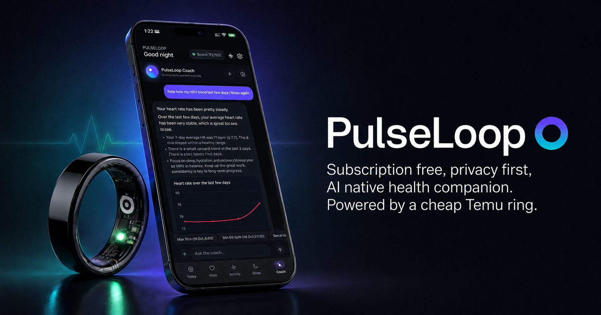
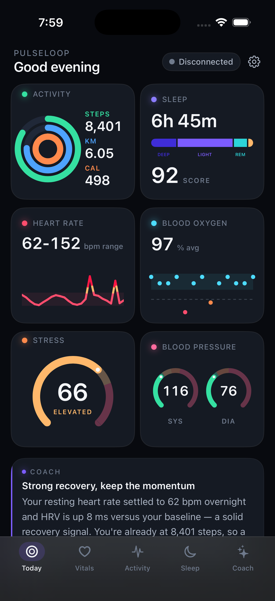
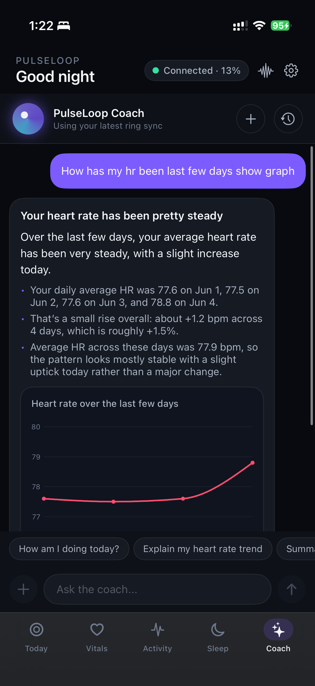
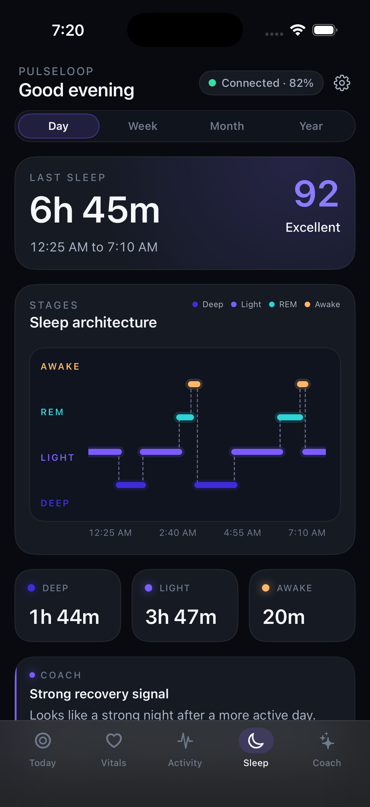
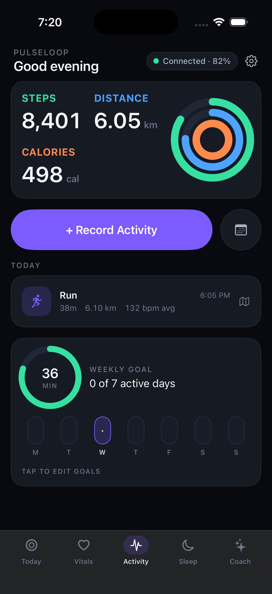
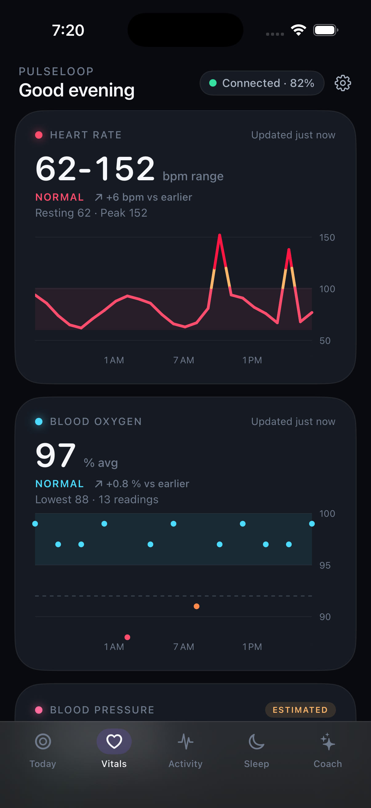
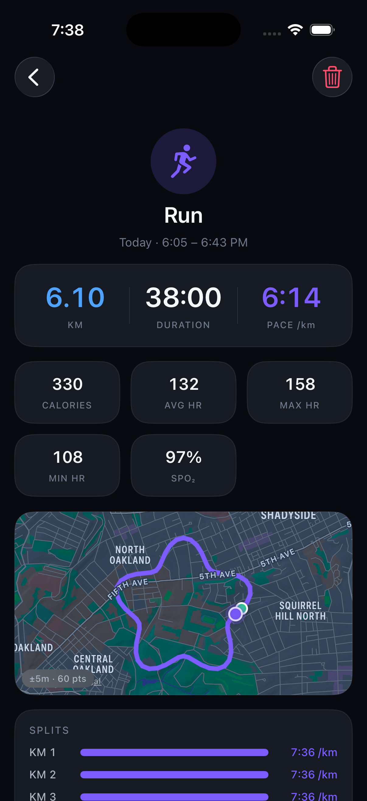

# PulseLoop

<!-- ===================== BADGES ===================== -->

  
  
  
  
  
  
  
  
  
  

  

<!-- ===================== TOP CALLOUTS ===================== -->

  <a href="https://saksham2001.github.io/PulseLoopiOS/"><b>📚 Documentation</b></a> ·
  <a href="https://github.com/foureight84/PulseLoopAndroid"><b>📱 Now on Android</b></a> ·
  <a href="https://discord.gg/t9y85ebaKD"><b>💬 Join the Discord</b></a> ·
  <a href="https://sakshambhutani.xyz/projects/20_project/"><b>📖 Read the writeup</b></a>

<!-- ===================== FEATURED / SHARED ON ===================== -->

<i>Featured on communities:</i>

  
  
  
  
  

PulseLoop is a native iOS health tracker for affordable Bluetooth smart rings,
with an **optional AI Coach**. It supports jring, Colmi / Yawell (QRing and
SmartHealth), R10M / LittleMeatball, and experimental TK5, LuckRing / TK18,
RWfit, and Colmi R11 / Da Rings integrations. See the
[supported rings and validation status](#supported-wearables) before pairing.

PulseLoop talks to the ring directly over Bluetooth LE (no vendor cloud, no
account) and layers an **optional** AI Coach on top of your own data. Instead of
static charts, you get a coach that can read your metrics, run its own
analysis, draw charts, remember context about you, and answer questions about
your sleep, heart rate, activity, and recovery.

> **Goal:** prove that a $20 ring + an LLM can replace a $300 subscription
> wearable, and that the "intelligence" should live on the phone, not behind a
> paywall.

## Documentation

📚 **Full docs: [saksham2001.github.io/PulseLoopiOS](https://saksham2001.github.io/PulseLoopiOS/)**

- [Getting started — iOS](https://saksham2001.github.io/PulseLoopiOS/getting-started/ios/)
- [Getting started — Android](https://saksham2001.github.io/PulseLoopiOS/getting-started/android/)
- [Supported hardware](https://saksham2001.github.io/PulseLoopiOS/hardware/)
- [iOS vs Android](https://saksham2001.github.io/PulseLoopiOS/platforms/ios-vs-android/)
- [Architecture](https://saksham2001.github.io/PulseLoopiOS/project/architecture/) · [Roadmap](https://saksham2001.github.io/PulseLoopiOS/project/roadmap/) · [Contributing](https://saksham2001.github.io/PulseLoopiOS/project/contributing/)

## What it does

- **Connects to the ring over BLE** and decodes its proprietary protocol
(heart rate, SpO₂, steps, distance, calories, sleep stages, raw packets).
- **Today / Vitals / Sleep / Activity** dashboards built natively in SwiftUI,
backed by SwiftData for local persistence.
- **AI Coach** — an agentic loop (OpenAI, Google Gemini, OpenRouter, MiniMax,
Apple's on-device Foundation Models, or **any OpenAI-compatible server you run
yourself** — Ollama, llama.cpp, vLLM, SGLang, LM Studio) with tools for data
retrieval, on-the-fly analysis, chart generation, and long-term memory.
Image input and web search depend on the provider and model. Optional AI actions
can update goals and log meals or workouts. See the
[local-model setup guide](https://saksham2001.github.io/PulseLoopiOS/local-llm-coach/)
to use a server you control.
- **Workout recording** with live heart-rate zones, GPS route maps, a Live
Activity, and a Dynamic Island widget.
- **Nutrition tracking** with meal logging, barcode scanning, calorie and macro
goals, and optional AI meal analysis.
- **Apple Health export** for supported ring metrics and workouts, with
per-type controls and an optional history backfill.
- **Strava workout uploads**, manually or automatically after a workout, in
builds configured with Strava API credentials.
- **Home Screen widgets** for daily activity and configurable metric tiles.
- **Daily check-in notifications** generated by the coach from your recent
trends.

> 📚 **Diagrams and a full walkthrough:
> [Architecture docs](https://saksham2001.github.io/PulseLoopiOS/project/architecture/).**

### Screenshots

| Today | AI Coach | Sleep |
| --- | --- | --- |
|  |  |  |

| Activity | Vitals | Workout Summary |
| --- | --- | --- |
|  |  |  |

## Also on Android

PulseLoop has a sister project for Android: **[PulseLoopAndroid](https://github.com/foureight84/PulseLoopAndroid)**

The two ports share BLE protocol research and coordinate fixes and new ring
support. Features and hardware validation can differ between platforms; see the
[iOS vs Android comparison](https://saksham2001.github.io/PulseLoopiOS/platforms/ios-vs-android/)
and each project's compatibility notes before choosing a build.

> Coordination, the shared roadmap, and cross-platform discussion all happen in
> the [Discord](#community).

## Community

We run a Discord for roadmap planning, getting-started help, and coordinating
the iOS + Android efforts. It's the fastest place to get unstuck, claim an
issue, or propose a feature.

**👉 [Join the PulseLoop Discord](https://discord.gg/t9y85ebaKD)**

New here? Good places to start:
- Skim the [open issues](https://github.com/saksham2001/PulseLoopiOS/issues),
  especially any tagged **good first issue**.
- Read [`CONTRIBUTING.md`](CONTRIBUTING.md) and the
  [`CODE_OF_CONDUCT.md`](CODE_OF_CONDUCT.md).
- Say hi in Discord and tell us what ring you have — device reports are
  genuinely useful.

## Supported Wearables

> **Disclaimer:** We have no affiliation with the sellers or manufacturers of
> any of the wearables listed below. We do not endorse them and take no
> responsibility for their quality, accuracy, performance, durability, data
> security, or anything else that might go wrong with them. Listings are
> provided for convenience only — links may break, sellers may swap hardware
> under the same name, change prices, and your unit may behave differently from mine. Buy at
> your own risk and treat any data the ring produces as approximate.

PulseLoop has **eight driver families**. The pairing catalog includes the models
below; a supported family does not mean every rebranded unit has been tested.
The app shows features according to the connected ring's capabilities.

| Ring / firmware | Models in the pairing catalog | Protocol | iOS support |
| --- | --- | --- | --- |
| [jring](https://saksham2001.github.io/PulseLoopiOS/hardware/jring/) | Generic `SMART_RING` / 56ff ring | Custom `56ff` | Supported |
| [Colmi / Yawell — QRing](https://saksham2001.github.io/PulseLoopiOS/hardware/colmi/) | Colmi R02, R03, R06, R07, R08, R09, R10, R11, R12, **Ring 2 Pro**; Yawell R05, R10, R11; H59 | QRing UART (`6e40fff0` / `de5bf728`) | Supported; sensor features vary by model |
| [Colmi / Yawell — SmartHealth](https://saksham2001.github.io/PulseLoopiOS/hardware/colmi/#smarthealth-app-colmi-rings) | **Colmi R99** defaults to SmartHealth; the other Colmi / Yawell / H59 cards also offer this firmware option | Yucheng YCBT (`be940`) | Supported; verified on an R99, with per-unit capability detection |
| [R10M / LittleMeatball](https://saksham2001.github.io/PulseLoopiOS/hardware/r10m/) | R10M | Yucheng YCBT (`be940`) | Supported; validated end to end on firmware 2.32 |
| [TK5](https://saksham2001.github.io/PulseLoopiOS/hardware/tk5/) | TK5 | Yucheng YCBT (`be940`) | **Limited** — driver implemented; TK5 hardware validation pending |
| [LuckRing](https://saksham2001.github.io/PulseLoopiOS/hardware/luckring/) | **TK18**; family matching also accepts LuckRing-app siblings, including some SIMSONLAB / Yoidesu rebrands | K6 (`F618`, manufacturer ID `0xFF64`) | **Limited** — TK18 tested; sibling models and some sensor readings remain unverified |
| [RWfit](https://saksham2001.github.io/PulseLoopiOS/hardware/rwfit/) | RWfit ring (generic card; SR16 / SY01 validation pending) | `A00A`, legacy `0x7E` / modern `0xAB` | **Limited** — SDK-derived implementation; successful hardware validation pending |
| [Colmi R11 — Da Rings](PulseLoop/RingProtocol/CRPCoordinator.swift) | **Colmi R11 (Da Rings app)** | CRP / Moyoung (`FDDA`) | **Limited** — some sleep and vital packets confirmed; full validation pending |

**Choose the app your ring shipped with.** Colmi branding and Bluetooth names
alone do not identify its firmware. For QRing or SmartHealth units, select the
matching app during pairing; PulseLoop offers a retry with the other app if
connection fails. The **Da Rings R11 uses a separate protocol**: select
**“Colmi R11 (Da Rings app)”**, even if Bluetooth calls it `SMART_RING`. RWfit-app
rings likewise use their own driver, including units sold under the Colmi name.

The Ring 2 Pro has model-specific support for on-demand HRV, stress, and skin
temperature. Those features are not promised for every QRing model.

**Not supported:** Oura, Ultrahuman, RingConn, and the SIMSONLAB **LA380-YJ**.
A SIMSONLAB-branded ring sold for the LuckRing app is a different device family.

> 📚 **Protocol details, capabilities, and known limitations:**
> [Supported hardware docs](https://saksham2001.github.io/PulseLoopiOS/hardware/).

## Install & try it

### 📲 TestFlight beta

The public TestFlight beta is live. **[Sign up here](https://docs.google.com/forms/d/e/1FAIpQLSfvrwie82qep-kJs8rmA0qhWBlWN4mjiwwG-86BlTR2974SsQ/viewform?usp=sharing&ouid=106402737727550537169)**
to request an invite, or ask on the [Discord](#community).

### 📦 Sideload an IPA

Download an unsigned IPA from the
[GitHub releases](https://github.com/saksham2001/PulseLoopiOS/releases) and sign it
with your own Apple account or certificate. See the
[sideloading guide](https://saksham2001.github.io/PulseLoopiOS/getting-started/sideloading/)
for signing options and App Group requirements for widgets.

### 🛠️ Build from source (Xcode)

Use **Xcode 26+** and an **iOS 18+ device** for Bluetooth ring testing. Open
`PulseLoop.xcodeproj`, select the `PulseLoop` scheme, and configure your **Team**,
unique **Bundle Identifiers**, and matching **App Group** for the app and both
extensions (`PulseLoopLiveActivityExtension` and `PulseLoopWidgetsExtension`).
Then build and run on your device.

A ring and an API key are optional for exploring the app: load demo data from
**Settings → Reseed demo data**. For the Coach, choose a hosted provider with
your own key, an Apple on-device model on an eligible iPhone running iOS 26+,
or a [local / self-hosted server](https://saksham2001.github.io/PulseLoopiOS/local-llm-coach/).

> 📚 **Full step-by-step build, signing, and demo-data instructions:
> [Getting started — iOS](https://saksham2001.github.io/PulseLoopiOS/getting-started/ios/).**
> Building on Android? See the
> [Android guide](https://saksham2001.github.io/PulseLoopiOS/getting-started/android/).

## Contributing

PRs and issues are very welcome — this project moves fast because people pitch
in. Before you start:

1. Read [`CONTRIBUTING.md`](CONTRIBUTING.md) and
[`CODE_OF_CONDUCT.md`](CODE_OF_CONDUCT.md).
2. Open or comment on an [issue](https://github.com/saksham2001/PulseLoopiOS/issues)
so we don't duplicate work.
3. CI runs automatically on every PR (build + SwiftLint): keep it green!
4. Coordinate bigger changes in the [Discord](#community), especially anything
that should land on Android too.

Adding a new ring? Start with the family and capability contracts in
[`PulseLoop/Wearables/`](PulseLoop/Wearables/), the drivers in
[`PulseLoop/RingProtocol/`](PulseLoop/RingProtocol/), and the pairing catalog in
[`WearableModel.swift`](PulseLoop/Wearables/WearableModel.swift). Device reports
with firmware versions and opt-in raw-packet diagnostics help validate the
limited-support drivers.

> 📚 The [roadmap](https://saksham2001.github.io/PulseLoopiOS/project/roadmap/) and
> [architecture / project layout](https://saksham2001.github.io/PulseLoopiOS/project/architecture/)
> now live in the docs.

## Acknowledgements

### Contributors

Thanks to everyone who's contributed to the iOS app 💜

<!-- CONTRIBUTORS:START -->
<!-- auto-generated by scripts/update_contributors.py — do not edit by hand -->
<table>
  <tr>
    <td align="center"><a href="https://github.com/saksham2001"> @saksham2001</a></td>
    <td align="center"><a href="https://github.com/rgvxsthi"> @rgvxsthi</a></td>
    <td align="center"><a href="https://github.com/hoveeman"> @hoveeman</a></td>
    <td align="center"><a href="https://github.com/foureight84"> @foureight84</a></td>
    <td align="center"><a href="https://github.com/radxp"> @radxp</a></td>
    <td align="center"><a href="https://github.com/ak710"> @ak710</a></td>
  </tr>
</table>
<!-- CONTRIBUTORS:END -->

The [contributors graph](https://github.com/saksham2001/PulseLoopiOS/graphs/contributors)
tracks code contributions. Thanks also to everyone who files issues, tests rings,
and shares device reports.

## License

This project is licensed under [Creative Commons Attribution 4.0 International (CC BY 4.0)](https://github.com/saksham2001/PulseLoopiOS/blob/main/LICENSE).

You're free to share and adapt the work, including commercially, **as long as
you give appropriate credit**. Please attribute:

> PulseLoop by Saksham Bhutani — <https://github.com/saksham2001/PulseLoopiOS>
